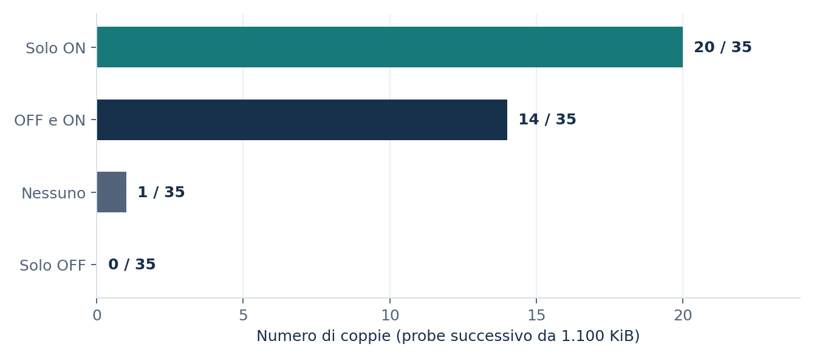

# Adaptive Data Exfiltration Detection - Experimental Validation

**Experiment window:** 30-31 October 2026. **Status:** completed in a controlled lab; evidence summarized below. **Mode:** detection-only (no scenario-specific Active Response).

This controlled evaluation extends the [28 October post-migration functional validation](../../../docs/data-exfiltration-validation-2026-10.md) without replacing its T01-T10 results. The objective is to distinguish: (1) live delivery, Zeek visibility and Wazuh alerting; from (2) the effect of a protected baseline on a *later* Adaptive probe. Neither series establishes real-world incident accuracy or unauthorized data theft.

## System under test

The controlled path was Client Linux synthetic sender -> RouterOS/pfSense -> Kali HTTP receiver; an OVS VLAN mirror delivered traffic to Zeek. Zeek estimated outbound TCP payload from **completed flows** and wrote `data_exfiltration.log` JSON. Wazuh collected selected decisions and evaluated [native XML rules](../../../blue-team/wazuh/rules/097_zeek_exfil_rules.xml) and [Slow persistence correlations](../../../blue-team/wazuh/rules/098_zeek_exfil_slow_persistence_rules.xml).

The protected learning mechanism is implemented in [adaptive.zeek](../../../blue-team/zeek/site/custom_scripts/data_exfiltration/adaptive.zeek) through `DataExfilAdaptive::delayed_learning_enabled`, a confirmation delay, learning suspension and pending-sample discard. The [remaining Zeek modules](../../../blue-team/zeek/site/custom_scripts/data_exfiltration/README.md) support flow estimation, quality control and Slow detection; it is **not** a separate Wazuh Python correlator.

### Frozen module identity

The six Zeek files in this repository snapshot match the six SHA-256 values declared in the frozen offline study design (`LG07-P`, `PREDEFINED_DESIGN.json`) **byte-for-byte**. That design pins historical commit `2752628d887efa9d9fc881c83ae2b8ec542613be`. This demonstrates file identity for the inspected archive; the archive contains no Git history and cannot establish the HEAD of an external branch.

## End-to-end detection validation - live trials

| Trial | Predefined synthetic workload | Sender/receiver/Zeek conn | Observed outcome |
|:---|:---|---:|:---|
| P01 | Authorized quiet period | 0/0/0 | No scenario-related candidate/alert |
| P02 | Authorized 256 KiB transfer | 1/1/1 | No candidate/alert |
| P03 | Simulated suspicious slow, 18 transfers | 18/18/18 | Slow candidate and Wazuh classification |
| P04 | Authorized slow, same shape, 18 transfers | 18/18/18 | Slow candidate and Wazuh classification |
| P05 | Authorized bulk, 5 MiB | 1/1/1 | Adaptive candidate; `111941` and `111942` |
| P06 | Simulated suspicious subthreshold, 12 transfers | 12/12/12 | No candidate/alert |

Across the five workload trials with nonzero planned transfers, **50/50** sends, receipts and Zeek completed connections were recorded. For P04, the operator audited original Wazuh alert IDs from the 30-31 October archives: distinct counts `111943=1`, `111944=1`, `111948=6` (eight distinct IDs total). An overlapping reduced-record extraction had counted eight `111948` rows; two were repeated representations. The six persistence alerts belong to **one** authorized episode, not six incidents. P03, P05 and P06 retain documented post-window timing/extraction caveats.

Source: [reduced live-trial table](../../../evidence/data-exfiltration/adaptive-validation/live_trial_summary.csv). Intent labels reflect the synthetic test plan, not an inference by the detector.

## Adaptive baseline robustness - matched OFF/ON replay

Five predefined held-out seeds (`13, 23, 41, 59, 83`) were applied to seven scripted profiles each: **35 paired PCAP cases**, analyzed in **70 isolated Zeek `-r` processes** with delayed learning OFF/ON. The primary comparison uses a *later separate 1,100 KiB Adaptive probe*, only when both modes report `ready` and an eligible quality state (35/35 pairs).

| Outcome | Learning Guard OFF | Learning Guard ON |
|:---|---:|---:|
| Scripted episodes with any candidate | 25/35 | 25/35 |
| Authorized profiles with episode candidate | 15/20 | 15/20 |
| Simulated suspicious profiles with episode candidate | 10/15 | 10/15 |

For the **later probe**, the paired decisions were `ON_only=20`, `both=14`, `neither=1`, `OFF_only=0`. The median Adaptive threshold difference ON minus OFF was **-216 KiB**, and the median p90 difference was **-317 KiB**. Guard ON discarded 375 learning samples across the scripted cases. Of the 20 ON-only probe decisions, **10 came from authorized profiles**; an ON-only result must not be interpreted as an additional detected attack. Packet-identical authorized-vs-simulated negative controls passed 10/10 comparisons: traffic volume and flow shape cannot reveal authorization intent.

Source: [35 original paired rows](../../../evidence/data-exfiltration/adaptive-validation/paired_off_on_cases.csv) and [per-profile aggregate](../../../evidence/data-exfiltration/adaptive-validation/profile_summary.csv).

## Evidence integrity and publication boundary

The original offline full-run manifest listed **431 files**. An operator executed the full-run hash audit on ZeekVM and reported `PASS, files_verified=431, files_missing=0, files_with_errors=0`; the reported manifest SHA-256 was `0f2af0ebbfc9186a09264698f91aa0c735580acc7a06acdcb6fc724b8194c363`. Nine exported analytical source files were also checked against that same manifest when the consolidated analysis was prepared. Same-run hash consistency does **not** independently authenticate origin. The raw PCAPs, sensitive logs and complete internal test runner are not included here, so the 35 offline cases cannot be fully regenerated from this public page alone.

## Interpretation and limits

- This is a deterministic, synthetic, topology-specific study, **not** a measured production false-positive rate, precision, recall or field detection efficacy.
- Identical traffic may be legitimate or adversarial depending on authorization and surrounding context; benign backup and simulated slow profiles were deliberately packet-identical within each seed.
- Zeek counts are completed-flow *estimates*; LG07-L receiver receipts were independently checked and must not be confused with Zeek's byte estimates.
- Adaptive and Slow candidate windows overlap; repeated Wazuh persistence rules do **not** enumerate independent incidents.
- A reboot/redeploy can reset in-memory baseline and rolling state; first windows, clock alignment and archived log rotation require explicit controls.
- No active response or automatic containment was enabled for the exfiltration scenario; no production endorsement of the lab thresholds is implied.

For the earlier system context and installation caveats, use the [Data Exfiltration scenario README](../../../scenarios/data-exfiltration/README.md). For dataset scope, see the [reduced evidence index](../../../evidence/data-exfiltration/adaptive-validation/README.md).

## Provenance: internal trial identifiers

The live validation is internally indexed as **LG07-L** (P01-P06) and the offline matched replay as **LG07-P**. These original identifiers are retained only to reconcile private run manifests, frozen hash records, raw experimental outputs and the published reduced tables. They do not define the public name or imply a particular number of revisions. The offline code identity refers to the pinned historical commit, not an independently fetched public HEAD.
